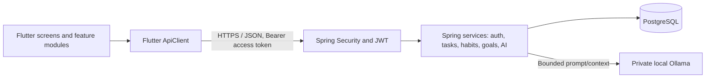
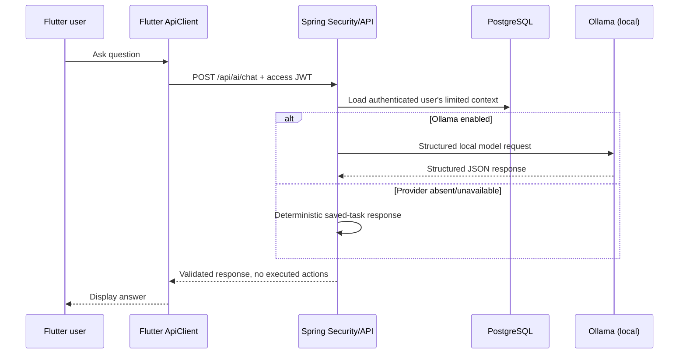

# Architecture

Flutter uses a centralized `ApiClient` with a compile-time `API_BASE_URL`, bearer authentication, refresh-token rotation, typed network errors, and a 20-second request timeout. `AuthService` stores both tokens through `flutter_secure_storage`. Task, habit, and goal services call REST endpoints; user preferences remain local in the current UI.

The backend uses Spring Boot 3.4 / Java 17, stateless Spring Security, BCrypt, JPA repositories, Flyway migrations, and DTO validation. Every domain query is scoped using the UUID extracted from the validated JWT security context. A request-supplied user ID is never used for authorization. Ollama is called only from the backend using the configured private base URL and model.

Quick Add follows a separate confirmation path: the AI endpoint returns validated suggestions without persisting them, and Flutter creates approved items through the existing task API. No AI-proposed action is directly applied to persistent data. Daily-plan output does not assign times while availability and fixed commitments are unavailable.

## Deliberate limitations

See [IMPLEMENTATION_STATUS.md](IMPLEMENTATION_STATUS.md): email workflows, calendar CRUD/conflict detection, offline sync, conversation persistence, rate limiting, and local-data import/export remain unfinished.
